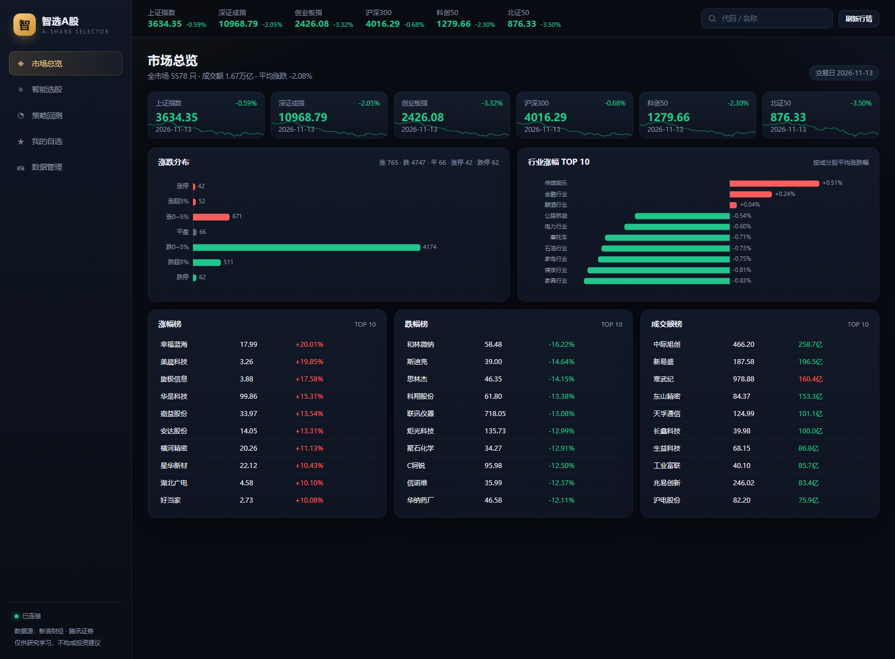
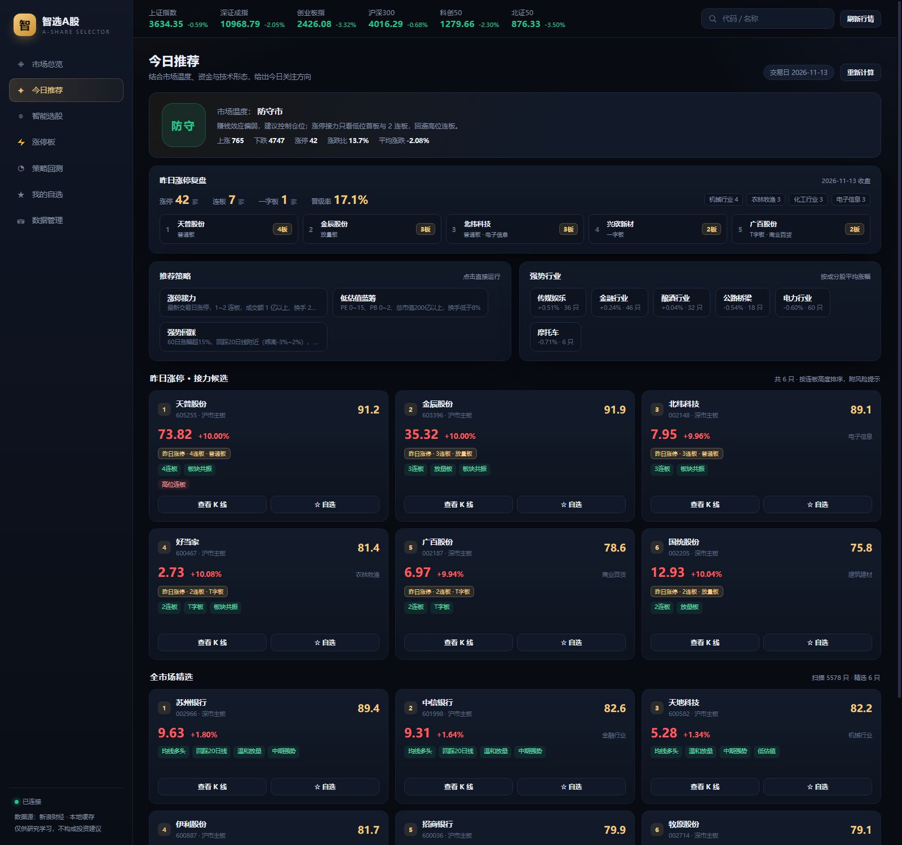
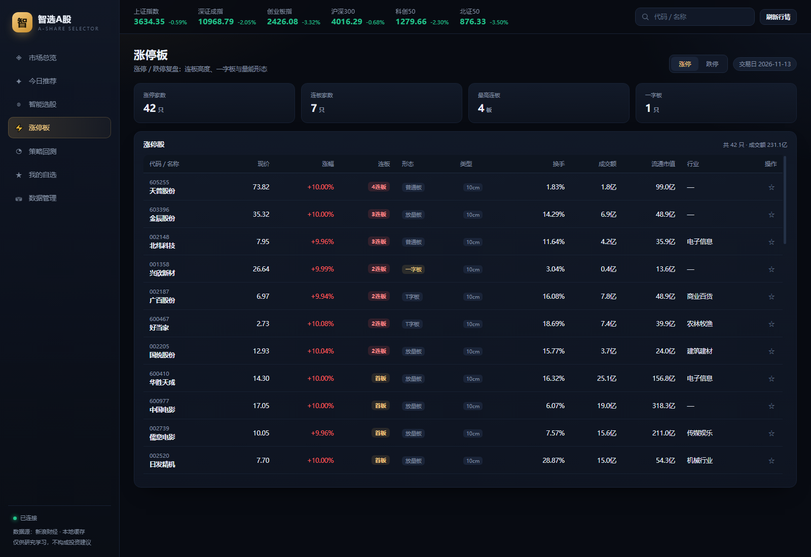
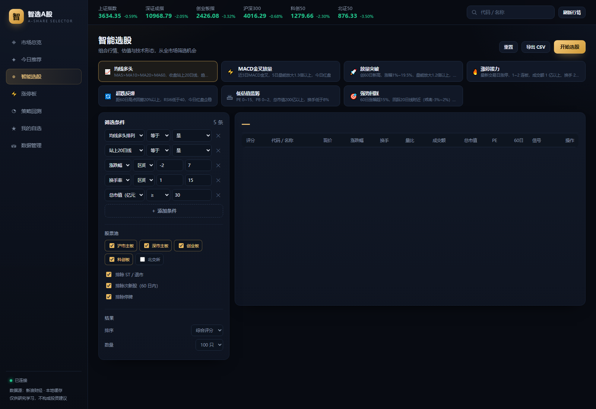
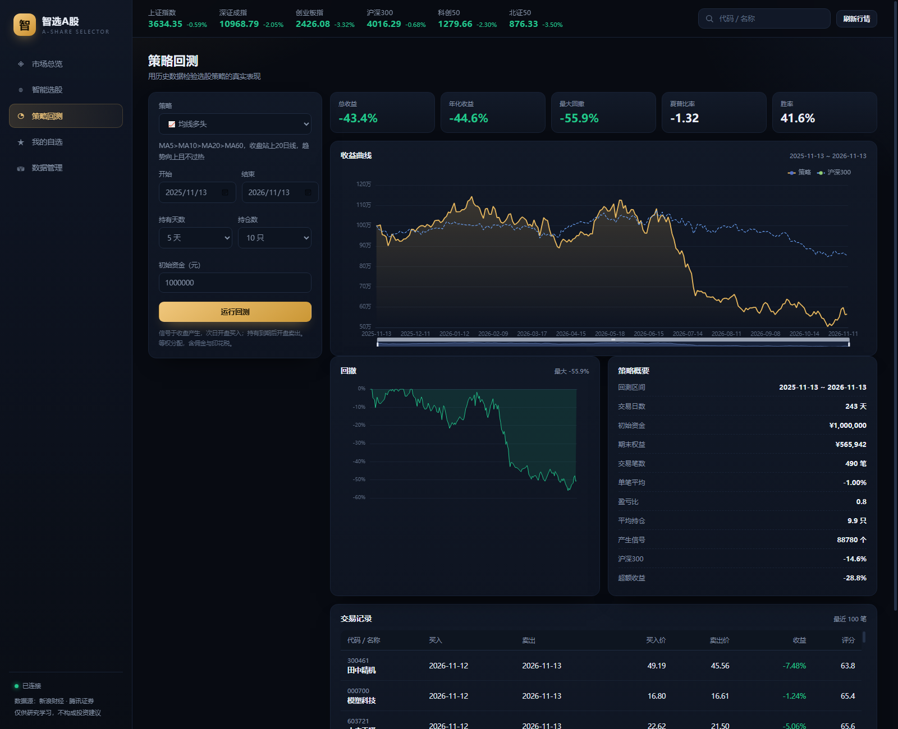

# 智选A股 · A股全市场选股与策略回测

> 本地运行、零第三方依赖的 A 股选股工具。全市场行情、涨停复盘、今日推荐、技术指标、条件选股、K 线图与策略回测，一个浏览器窗口全部搞定。
>
> 项目根目录：`ashare-selector/`



## 功能

### 市场总览
- 上证、深证、创业板、沪深300、科创50、北证50 六大指数实时点位与走势
- 涨跌分布、涨停/跌停家数、两市成交额
- 行业涨幅榜（49 个新浪行业分类）
- 涨幅榜 / 跌幅榜 / 成交额榜 TOP10

### 今日推荐
- 昨日涨停复盘：涨停家数、连板家数、一字板、晋级率、最强板块与连板龙头
- 推荐分两部分：**昨日涨停 · 接力候选 6 只**（按连板高度排序，高位连板标注风险）+ **全市场精选 6 只**
- 市场温度判断（进攻 / 震荡 / 防守），并推荐 3 套匹配策略（含「涨停接力」）
- 每只附带推荐理由与风险提示，行业最多保留 2–3 只



### 涨停板
- 涨停 / 跌停一键切换，统计涨停家数、连板家数、最高连板、一字板
- 连板梯队：首板、2 连板、3 连板、4 板以上，按高度排序
- 形态识别：一字板、T 字板、放量板、缩量板、普通板
- 类型标注：10cm / 20cm / 30cm / ST 5%
- 展示换手、成交额、流通市值、近 20 日涨停次数，点击查看 K 线



### 智能选股
- 7 套内置策略：均线多头、MACD 金叉放量、放量突破、涨停接力、超跌反弹、低估值蓝筹、强势回踩
- 32 个可选字段自由组合：行情、估值、技术形态、涨停与连板，支持 ≥ / ≤ / 区间 / 等于
- 全市场扫描约 0.5 秒，结果按综合评分排序
- 一键导出 CSV（Excel 可直接打开）



### 个股详情
- 前复权日 K 线 + MA5/10/20/60 + 成交量 + MACD
- 实时行情、换手、量比、市值、PE/PB、RSI、60 日涨幅、距 60 日高点
- 星标加入自选，支持深链接 `?stock=600000`

### 策略回测
- 用任意预设策略或当前选股条件，回测近一年历史表现
- 收盘产生信号 → 次日开盘买入 → 持有 N 日 → 开盘卖出，等权分配
- 自动计入佣金（万三）与印花税（万五），按手（100 股）成交
- 总收益、年化、最大回撤、夏普、胜率、盈亏比、超额收益
- 收益曲线对比沪深300、回撤曲线、逐笔交易记录



### 自选股与数据管理
- 自选列表批量实时报价：一次请求刷新全部自选，盘中每 15 秒自动刷新（收盘后 60 秒）
- 显示现价、涨跌幅、换手、成交额、市值、PE、60 日涨幅
- 本地行情缓存、同步进度、数据库状态
- 增量更新约 1 分钟（已最新时几秒），全量重建约 2 分钟

## 快速开始

**环境要求：Python 3.10 及以上，无需安装任何第三方库。**

### Windows

1. 双击 `启动选股软件.bat`
2. 浏览器自动打开 <http://127.0.0.1:8765>
3. 首次使用进入「数据管理」，点击 **全量重建**，等待约 2 分钟
4. 「今日推荐」看市场温度与精选标的，「涨停板」复盘连板梯队
5. 「智能选股」选择策略或自定义条件，点击 **开始选股**

> 仓库内置了 **2026-11-17 收盘** 的行情数据库快照（xz 分卷，约 106MB）。克隆后首次启动会自动还原到 `data/ashare.db`（约 20 秒），无需先做全量重建；需要最新数据时再点「增量更新」即可。

### Ubuntu / Debian

```bash
sudo apt update && sudo apt install -y python3   # Ubuntu 22.04+ 自带 3.10+
cd ashare-selector
chmod +x start.sh
./start.sh
```

- 桌面版会自动打开浏览器；服务器版不会打开，用 SSH 隧道访问：
  ```bash
  ssh -L 8765:127.0.0.1:8765 user@your-server
  ```
  然后在本机浏览器打开 <http://127.0.0.1:8765>
- 需要局域网直接访问时：`ASHARE_HOST=0.0.0.0 ./start.sh`（请自行评估防火墙与安全风险）
- 停止：在运行窗口按 `Ctrl+C`

### 通用命令行

```bash
python3 app.py                          # 自动打开浏览器
python3 app.py --no-browser             # 不打开浏览器
ASHARE_PORT=9000 python3 app.py         # 指定端口
ASHARE_HOST=0.0.0.0 python3 app.py      # 监听所有网卡
```

## 目录结构

```
.
├── 启动选股软件.bat      # Windows 双击启动
├── start.sh              # Ubuntu / Debian 启动脚本
├── app.py                # 启动入口
├── ashare/
│   ├── config.py         # 路径、端口、指数配置
│   ├── net.py            # HTTP 客户端（IPv4 / TLS1.2 / 重试）
│   ├── datasource.py     # 新浪 + 腾讯数据源
│   ├── store.py          # SQLite 存储（日线二进制压缩）
│   ├── indicators.py     # MA/MACD/KDJ/RSI/BOLL
│   ├── screener.py       # 条件、预设、评分、筛选
│   ├── picks.py          # 涨停梯队、今日推荐
│   ├── limits.py         # 涨停判定与连板规则
│   ├── dbseed.py         # 内置数据库快照还原
│   ├── backtest.py       # 回测引擎
│   ├── updater.py        # 数据同步
│   ├── api.py            # API 聚合
│   └── server.py         # 本地 HTTP 服务
├── web/                  # 前端（原生 JS + ECharts）
├── data/ashare.db        # 本地行情数据库
└── docs/                 # 截图
```

## 数据说明

| 项目 | 说明 |
| --- | --- |
| 行情快照 | 新浪财经全市场接口，5578 只 A 股，约 10 秒刷新 |
| 日线 | 新浪财经日线（最多 900 个交易日），按涨跌幅上限识别送转做近似前复权 |
| 行业分类 | 新浪行业分类，共 49 个（覆盖约 2600 只，未覆盖的显示为 — ） |
| 技术指标 | 同步时预计算并缓存，选股时直接读取 |
| 增量更新 | 收盘后用快照 OHLC 直接合并当日日线（约 40–60 秒），不再逐只抓 K 线 |
| 全量重建 | 逐只抓取 900 根日线并重算指标，约 2 分钟 |
| 内置快照 | `data/ashare.db.xz.part1..4`，2026-11-17 收盘，首次启动自动还原 |
| 复权处理 | 优先前复权；新浪源按涨跌幅上限识别送转并做近似前复权 |
| 存储 | SQLite（WAL），每只股票一条二进制 K 线记录，约 200 MB |

行情数据来自公开接口，仅用于个人研究，请勿用于商业分发。

## 策略与回测规则

**综合评分**（0–100）由当日涨幅、60 日涨幅、换手、量能、均线形态、距高点回撤、RSI 位置、估值等加权得到，用于结果排序。

**今日推荐的涨停池逻辑**

- 先统计最近交易日涨停池：家数、连板数、一字板、晋级率（昨日涨停今日继续涨停 / 昨日涨停总数）
- 按连板高度、封板形态（一字 / T 字 / 放量 / 缩量）、成交额、换手、流通市值、20 日涨停次数与板块共振打分
- 接力候选按连板高度排序，4 板以上标注「高位连板」风险；评分随市场温度调整，进攻日抬高高标权重，防守日压低高位连板分数
- 12 只推荐 = 涨停池 6 只 + 全市场多因子 6 只；ST、低价、停牌不参与

**回测规则**

- 以每日收盘数据计算信号，次日开盘价买入
- 买入时跳过一字涨停、停牌；按 100 股整手下单
- 持有 N 个交易日后，以开盘价卖出
- 最多持有 M 只，等权分配，现金不足时按可用资金买入
- 费用：买入万三、卖出万八（含印花税）
- 基准：沪深300 买入持有

**已知限制**

- 历史 PE/PB 不可得，含估值条件的策略在回测中会忽略这些条件
- 历史市值用当前股本 × 当日收盘价近似
- 新浪日线为不复权，送转通过涨跌幅上限识别，极小概率漏判

## 常见问题

**端口被占用？** 程序会自动尝试 8766–8795，控制台会打印实际地址。

**同步失败？** 数据源偶发限流，程序内置 5 次指数退避重试；失败后重新点击即可，已下载数据不会丢失。

**数据过期？** 每个交易日收盘后点击「增量更新」，或直接「全量重建」。

**想改端口？** 设置环境变量 `ASHARE_PORT`，或修改 `ashare/config.py`。

**想改监听地址？** 设置 `ASHARE_HOST=0.0.0.0`（默认仅本机 `127.0.0.1`）。

## 技术设计

- **零依赖**：后端只使用 Python 标准库（`http.server`、`sqlite3`、`urllib`），前端原生 JS + 本地 ECharts
- **数据层容错**：强制 IPv4、TLS 1.2、失败重试、多数据源回退
- **写入优化**：日线按股票打包成单条 BLOB，5578 行替代 500 万行，同步从数小时降到 3 分钟
- **指标缓存**：所有技术指标（含连板数、涨停/跌停标记）在同步时预计算，选股只做内存过滤
- **收盘快照合并**：增量更新直接用行情快照中的当日 OHLC 追加日线，免去 5500 次 K 线请求；仅在除权、缺数据或盘中回退到逐只抓取
- **回测加速**：条件字段预计算为数组，逐日评估避免重复构造字典

## 免责声明

本软件仅用于技术学习与量化研究，所有数据与选股结果不构成任何投资建议。股市有风险，投资需谨慎。
